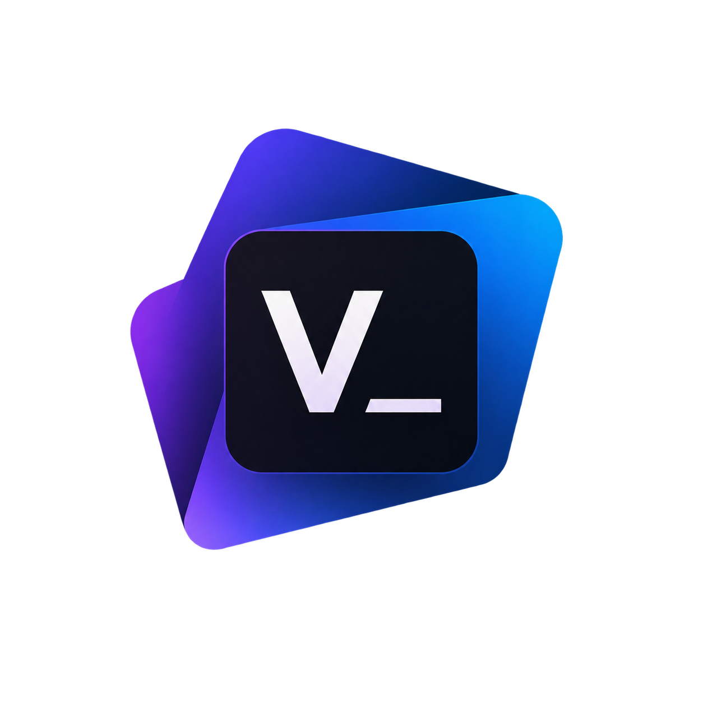
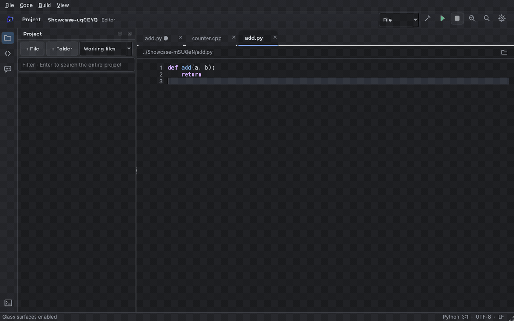
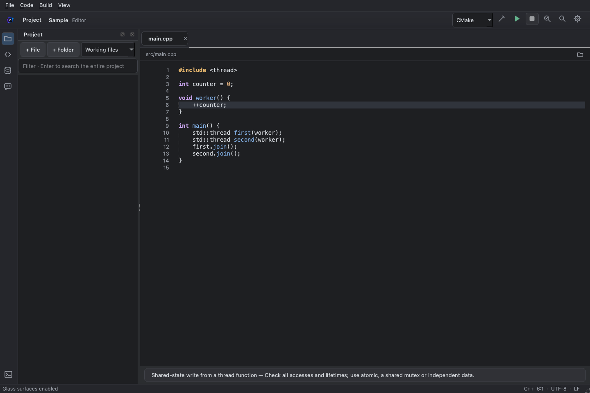
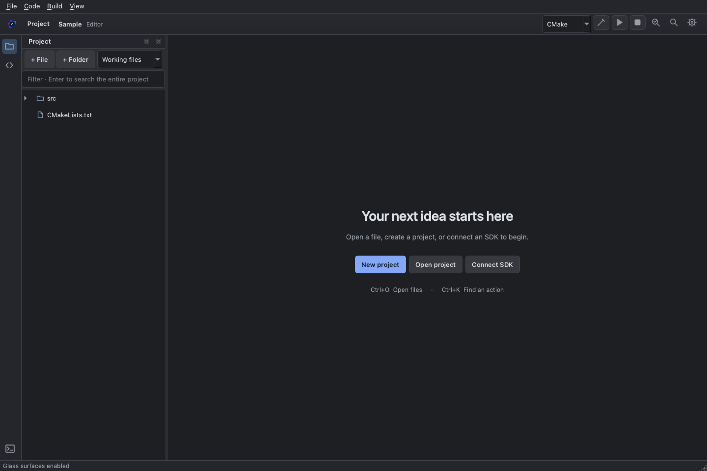
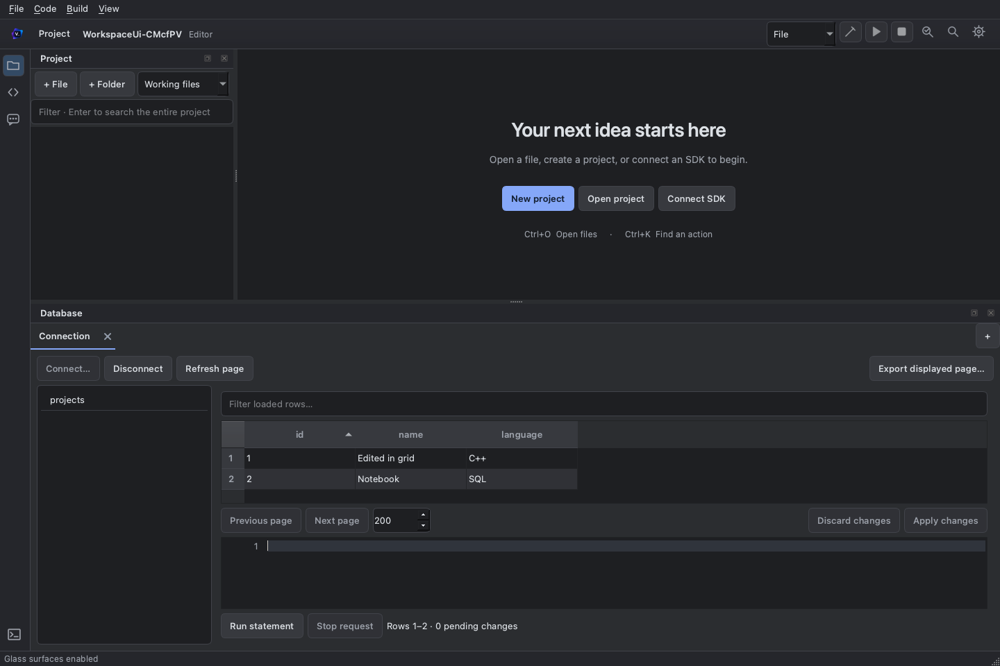
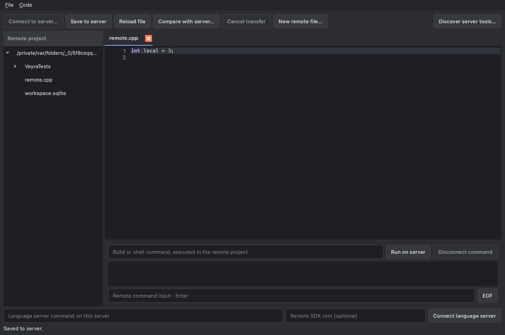

<p align="center">
  
</p>

<h1 align="center">Veyra IDE</h1>

<p align="center">
  <a href="CMakeLists.txt"></a>
  <a href="#source-build-requirements"></a>
  <a href="https://github.com/alman790/Veyra-IDE/actions/workflows/ci.yml"></a>
  <a href="https://github.com/alman790/Veyra-IDE/releases/latest"></a>
  <a href="LICENSE"></a>
  <a href="#contributing"></a>
</p>

Veyra is a native IDE for code, live thread feedback and local AI. Its C++/Qt interface runs without Electron, and the bundled Qwen model works in-process: no account, API key or model server is needed for local assistance. Connect your SDK and language server for semantic editing, build projects, and debug with LLDB.

The bundled model is approximately 491 MB. Thread feedback combines source heuristics with optional model ranking; it does not prove the absence of data races.

## See it in use



A continuous recording of the native interface: live thread feedback, a completion menu, and an inline continuation generated by the bundled model and accepted with Tab. Playback follows the recorded timing.

## Screenshots

The editor with live thread feedback:



The welcome screen after closing the last document:



Interactive database tables and the remote editor, shown with disposable test data:





## Install a release

Download a package from [Releases](https://github.com/alman790/Veyra-IDE/releases/latest). All packages include the local model. Windows and macOS packages also include Qt; Linux packages use distribution libraries. A source checkout and Git LFS are not required to run a release build.

| Platform | Package |
| --- | --- |
| Windows x86-64 | [Installer](https://github.com/alman790/Veyra-IDE/releases/download/v2.2.0/VeyraIDE-2.2.0-windows-x86_64-setup.exe) · [ZIP](https://github.com/alman790/Veyra-IDE/releases/download/v2.2.0/VeyraIDE-2.2.0-windows-x86_64.zip) |
| macOS Apple Silicon | [DMG](https://github.com/alman790/Veyra-IDE/releases/download/v2.2.0/VeyraIDE-2.2.0-macos-arm64.dmg) · [PKG](https://github.com/alman790/Veyra-IDE/releases/download/v2.2.0/VeyraIDE-2.2.0-macos-arm64.pkg) |
| macOS Intel | [DMG](https://github.com/alman790/Veyra-IDE/releases/download/v2.2.0/VeyraIDE-2.2.0-macos-x86_64.dmg) · [PKG](https://github.com/alman790/Veyra-IDE/releases/download/v2.2.0/VeyraIDE-2.2.0-macos-x86_64.pkg) |
| Linux x86-64 | [DEB](https://github.com/alman790/Veyra-IDE/releases/download/v2.2.0/VeyraIDE-2.2.0-linux-x86_64.deb) · [RPM](https://github.com/alman790/Veyra-IDE/releases/download/v2.2.0/VeyraIDE-2.2.0-linux-x86_64.rpm) · [tar.gz](https://github.com/alman790/Veyra-IDE/releases/download/v2.2.0/VeyraIDE-2.2.0-linux-x86_64.tar.gz) |

Verify downloads against `SHA256SUMS.txt` attached to the release. Linux packages use system Qt libraries and were built on Ubuntu 24.04. macOS bundles are ad-hoc signed, not notarized; Windows installers are not code-signed. SDKs, language servers, and LLDB adapters are connected separately.

## Features

- **Editing:** document tabs, session recovery, whole-line gutter selection, bookmarks, navigation history, automatic bracket and quote pairing, completion menus, inline continuations, and Markdown preview. Documents up to 32 MiB are supported.
- **Language tooling:** SDK discovery and selection, LSP diagnostics, semantic highlighting, completion, definitions, references, rename, hover documentation, and formatting. Availability depends on the connected language server.
- **Project workflow:** project creation, a searchable file tree, project-wide search and replace, an integrated terminal, and Git status and diff tools. Optional editor annotations show line authors and commits, including the effect of unsaved changes.
- **Build and run:** adapter-defined compiler commands and CMake project support, including target discovery through the CMake File API and Debug/Release configurations.
- **Remote development:** OpenSSH projects in a separate workspace, remote file editing and commands, explicit server tool discovery, and language servers running on the server. Saves detect conflicts and provide a comparison before replacing a changed file.
- **Database tools:** independent connection tabs, schema/table browsing, editable grids, pagination, filtering and sorting of loaded rows, SQL execution, cancellation, and CSV export. Drivers are discovered from Qt plugins.
- **Native debugging:** LLDB breakpoints, stepping, call stacks, local variables, expression evaluation, and program input/output.
- **Thread review:** live source diagnostics and localized recommendations, with optional local model ranking.
- **Local inference:** Qwen2.5-Coder 0.5B in Q4_K_M format, approximately 491 MB, executed in-process through llama.cpp. No model service is required. Inline suggestions are accepted with Tab and dismissed with Escape.
- **Project agent:** contextual questions and reviewed repair proposals using the active buffer, selected code, neighboring files, adapter-defined project configuration, SDK information and available compiler/LSP diagnostics. Uses bundled Qwen locally or API providers configured directly in Veyra through the optional Beamcore runtime.
- **Interface:** dark theme, configurable shortcuts, and English/Russian localization. A fresh installation starts in English.

Language adapters describe file types, project templates, compiler recipes, and language-server configuration. SDK discovery is read-only; connecting an SDK or installing language tooling requires an explicit action. Adapters can be imported without rebuilding the IDE.

Click the outer gutter to toggle a bookmark, the adjacent lane to toggle a breakpoint, or drag over line numbers to select complete lines. Markers follow edits and are restored with the document session. Use **Code → Show Git annotations** or the gutter context menu to display authorship. Hover an annotation for the author, date, commit and subject; click it to open the commit diff in the Git tool window. Annotations use the current buffer, so inserted or modified lines appear as uncommitted until they are committed.

| Navigation | Shortcut |
| --- | --- |
| Back / forward, including document tabs | Alt+Left / Alt+Right |
| Toggle bookmark | F11 |
| Next / previous bookmark | Ctrl+F11 / Ctrl+Shift+F11 |
| Completion menu | Ctrl+Space |

The completion menu supports arrows, Page Up/Down, Enter or Tab to accept, and Escape to dismiss. Local word suggestions use nearby code; project-wide semantic candidates come from the connected language server.

## Remote development

Choose **File → Remote development…**, then **Connect to server…**. Enter an SSH host alias or address and the project directory. Veyra uses the OpenSSH client on your machine, including existing SSH configuration and jump hosts. The server needs a POSIX shell and standard utilities; no Veyra agent or model runtime is installed there.

Authentication currently uses identity keys or a local SSH agent. Unlock encrypted keys in the agent before connecting. Host key verification remains enabled. For a new direct host, **Verify host key…** shows SHA-256 fingerprints; compare them with the administrator's fingerprints before trusting the key. For proxy or jump connections, verify the destination with your existing SSH client first. Trust recorded in Veyra is kept separately from your existing `known_hosts` files.

Open files from the remote tree, save with `Ctrl+S`, and use the command field for server-side builds or shell commands. Uploads preserve UTF-8 BOM and CRLF where present, check the previously read file version, and replace the file through a temporary file in the same directory. If the server copy changes, review the two versions before choosing which to keep. Files must be UTF-8 text below 32 MiB. Symbolic links are displayed but not traversed.

**Discover server tools…** searches the server PATH using registered language adapters. Connect a language server explicitly, or enter its server-side command and an optional SDK root. Completion, diagnostics, formatting and in-project definitions use that remote process. Local SDK settings are not applied to the server. Commands and file transfers use separate SSH sessions, so editing can continue during a build. Disconnecting a command closes its SSH session; it does not guarantee termination of detached server processes.

## Database tools

Open **View → Database**, then **Connect…**. Use `+` to open another independent connection. Choose an available driver and supply the database or connection name; network drivers also accept a host, port, user, password and driver options. Passwords remain in memory and are not written to connection profiles.

SQLite is included in release packages. Other SQL engines require a compatible [Qt SQL driver plugin](https://doc.qt.io/qt-6/sql-driver.html) and its client libraries. **Load driver plugins…** accepts a Qt plugin directory containing `sqldrivers`; plugins must match the Qt version and architecture of the application. This is a SQL workspace, not a generic NoSQL client. SQLite and PostgreSQL have integration coverage; other drivers depend on their own capabilities.

Open a table on the left to browse pages. Sorting and filtering operate on the loaded page. Edit a non-key cell, or use **Set NULL**, then **Apply changes** or **Discard changes**. Grid editing requires a primary key and transaction support. Updates use bound parameters and compare the original cell value; a conflict rolls back the submitted group on transactional tables. Primary keys, binary cells and truncated cells are read-only. Use a read-only database account when browsing production data.

The SQL console runs the selection, or its full text, with **Run statement** (`Ctrl+Enter`). Each execution is explicit. Results are cached up to 5,000 rows or 8 MiB, so paging never repeats a statement such as `INSERT … RETURNING`. Narrow the query when a result is capped. **Stop request** terminates the connection worker; reconnect to continue. Each connection runs in its own process, keeping blocked database drivers out of the editor process.

**Export displayed page…** exports the loaded, filtered rows as CSV, including the visible NULL, binary and truncation markers. It is a display export, not a database backup.

## Project agent

Open **Code → Project agent** (`Alt+7`) or use the chat button in the tool rail. **Ask** requests an explanation; **Propose fix** requests reviewed source changes. Describe the problem or select the code you want reviewed. The agent can read additional project files and search symbols before responding. The context is bounded; large files are supplied as excerpts around the cursor, and related buffers include unsaved changes.

**Bundled Qwen** runs inside Veyra with an 8,192-token context window. It requires no API key or background model server. Identifier corrections are drawn from project code and ranked by Qwen; broader proposals use constrained generation. The 0.5B model is suited to focused questions and small repairs; use a larger model through a provider for difficult refactoring or broad architectural work.

To use [Beamcore](https://github.com/beamcore/agent), install its release runtime, then select **Configure…** in the agent panel. Add a provider name, API endpoint, model and authentication key directly in Veyra. The runtime executable can be selected in the same dialog if `beamcore` is not on PATH. Veyra launches the runtime on demand through its `eval` interface and an IDE-owned adapter. Provider settings persist in Veyra's private configuration, with credentials encrypted by Beamcore. An existing Beamcore configuration is imported on first use; the original configuration and Beamcore repository are not modified. API keys are not stored in project files. The integration is tested against Beamcore 1.0.0's provider and chat APIs.

When Beamcore is available, the same adapter can route local inference back to Veyra's bundled Qwen. Without a compatible runtime, local mode works directly. External requests use the selected Beamcore provider and model; project context is sent only when a request is submitted with that provider selected. Beamcore itself is an optional, separately installed runtime; its upstream platform support determines where that integration can run.

Review the proposed replacements before choosing **Apply proposal**. Each replacement must match one unique source location, and every affected buffer is checked against its original snapshot before any edit is made. Changes go into editor buffers, with one undo operation per document. They are not saved automatically. **Build to verify** uses the normal build workflow and selected toolchain; the agent does not claim a successful build from a generated answer. Existing build output may describe an earlier saved version of a file.

Project search, the focused file tree and agent context use `.gitignore` rules, nested ignore files, Git's global exclusions and `.git/info/exclude`. A `.veyraignore` file can add IDE-specific rules, including negation. Directory names such as `build` or `node_modules` have no special meaning; add them to your project's rules when appropriate. Git and Veyra's own internal directories remain excluded.

Context lookup excludes external symlinks, common credential files, project-ignored paths and binary model weights. The agent's tools read and search project code; they do not execute model-generated shell commands or Elixir expressions.

## Source build requirements

| Component | Requirement |
| --- | --- |
| Compiler | C++20-capable compiler; MSVC, Clang, or GCC |
| Build system | CMake 3.20 or later |
| UI framework | Qt 6.2 or later: Core, Widgets, Concurrent, Sql; Test for the test suite |
| Model checkout | Git LFS |
| Native debugging | LLDB DAP adapter (`lldb-dap`, or the older `lldb-vscode`) |
| Language services | An SDK and a compatible language server for each language in use |

The model is stored in Git LFS. After cloning this repository, run:

```sh
git lfs install --local
git lfs pull
```

Local inference uses the CPU runtime. Optional backends that require external code generators are excluded from this build.

## Build and installation

Run these commands from the repository root. Build directories are excluded from Git.

### macOS

Install the Xcode Command Line Tools, then install the build dependencies:

```sh
brew install cmake qt git-lfs
git lfs install --local
git lfs pull
cmake --preset macos -DCMAKE_PREFIX_PATH="$(brew --prefix qt)"
cmake --build --preset macos
ctest --preset macos
open out/macos/artifacts.noindex/VeyraIDE.app
```

For a distributable bundle and DMG/PKG installers:

```sh
cmake --build out/macos --target installer
```

The files are written to `out/macos/deployment.noindex/`. Open the DMG and drag Veyra IDE to Applications. The packaging target uses an ad-hoc signature; Developer ID signing and notarization require release credentials.

### Linux

On Ubuntu or Debian, install the build dependencies and optional C++ language/debugging tools:

```sh
sudo apt-get update
sudo apt-get install -y build-essential cmake qt6-base-dev libqt6sql6-sqlite libgl1-mesa-dev libxkbcommon-dev git-lfs clangd lldb
git lfs install --local
git lfs pull
cmake --preset linux
cmake --build --preset linux
ctest --preset linux
./out/linux/VeyraIDE
```

Install the application with `sudo cmake --install out/linux`. The `installer` target creates packages under `out/linux/packages.noindex/`; DEB and RPM generation depend on the corresponding packaging tools being installed.

### Windows

Install Visual Studio 2022 with the C++ desktop workload, CMake, Git LFS, and a Qt 6 build for MSVC 2022 x64. From a developer PowerShell, set the Qt path to the version installed on your machine:

```powershell
git lfs install --local
git lfs pull
$qt = "C:/Qt/6.8.3/msvc2022_64"
$env:PATH = "$qt/bin;$env:PATH"
cmake --preset windows -DCMAKE_PREFIX_PATH="$qt"
cmake --build --preset windows
ctest --preset windows
cmake --build out/windows --target deploy --config Release
.\out\windows\deployment.noindex\VeyraIDE.exe
```

The deployment target includes the Qt runtime. The `installer` target creates an NSIS installer when NSIS is available, along with a ZIP package.

### Build without the model

Configure with `-DTS_LOCAL_MODEL=OFF` to omit local inference and the bundled weights. SDK/LSP completion and source diagnostics remain available. A headless core build also accepts `-DTS_BUILD_GUI=OFF`; Qt Core is still required.

## First project

1. Choose **New project** or **Open project** on the welcome screen.
2. Use **Connect SDK** to inspect detected toolchains or select an SDK directory. Confirm the toolchain you want to connect.
3. Configure a language server in Settings. Where an adapter provides an installation recipe, review the command before selecting **Install and connect**.
4. Select the source file or CMake target, then build or run it. For a native executable, use F5 to start LLDB debugging.

Project configuration is stored in `.veyra/`. Custom SDK adapters may be supplied as `veyra-languages.json` or imported from Settings. The built-in adapter schema and recipes are in [resources/languages.json](resources/languages.json).

## Contributing

Start with a scoped task: [copy grid selections](https://github.com/alman790/Veyra-IDE/issues/4) or [remember column widths](https://github.com/alman790/Veyra-IDE/issues/5) are marked `good first issue`. [MariaDB integration coverage](https://github.com/alman790/Veyra-IDE/issues/6) and [managed SSH database tunnels](https://github.com/alman790/Veyra-IDE/issues/7) are marked `help wanted`.

Open an issue for substantial changes before implementing them. For a bug report, include the operating system, compiler/Qt versions, selected SDK and language server, and steps to reproduce the problem.

See the [contribution guide](.github/CONTRIBUTING.md), [community guidelines](.github/CODE_OF_CONDUCT.md), and [security policy](.github/SECURITY.md). Use [Issues](https://github.com/alman790/Veyra-IDE/issues/new/choose) for reproducible bugs and proposals, or [Discussions](https://github.com/alman790/Veyra-IDE/discussions) for questions.

Keep pull requests focused. Include a regression test when behavior changes, and describe the checks you ran. Preserve the licenses and provenance of bundled dependencies.

```sh
cmake --build <build-directory> --target check
cmake --build <build-directory> --target format-check translations-check
```

The formatter requires clang-format 22 or later. Run `cmake --build <build-directory> --target format` to apply the repository style. Amalgamated libraries under `third_party/llama/vendor/` retain their upstream formatting.

## Continuous integration

The [CI workflow](.github/workflows/ci.yml) defines native build, test, deployment, and installer jobs for Linux, macOS, and Windows. Separate jobs cover ASan/UBSan, the Fedora core build, formatting, translation coverage, and a real PostgreSQL service. Tool-dependent integration tests report a skip when their required backend is unavailable.

## Contributors

<a href="https://github.com/alman790"></a>

Created and maintained by [alman790](https://github.com/alman790). The [contributors graph](https://github.com/alman790/Veyra-IDE/graphs/contributors) records contributions from repository history.

## Dependencies and scope

Third-party notices are in [licenses/](licenses/). The model's source revision and checksum are recorded in [its manifest](resources/models/manifest.json).

Refactoring support follows the connected language server. The integrated debugger targets native programs through the LLDB DAP adapter. The client and developer tools are implemented in C++; the application does not require a Python interpreter.

## License

Copyright (c) 2026 alman790. The application source is distributed under the [MIT License](LICENSE). Bundled dependencies retain their own licenses.

Third-party components retain their respective licenses.

- **Qt 6** — licensed under applicable Qt licensing terms.
- **llama.cpp** — MIT License.
- **Qwen2.5-Coder** — Apache License 2.0.
- **Beamcore** — optional, separately installed integration;
  subject to its own licensing terms.

See [Third-Party Notices](licenses/THIRD_PARTY_NOTICES.txt)
for additional information.
